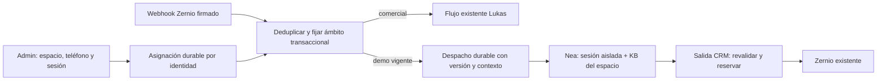

# Demo Center V1 — ARQ-01: arquitectura

Estado: PLANEADO; ARQ-01 cerrado documentalmente el 2026-11-04 con aprobación conceptual del propietario. Implementación pendiente y no autorizada en esta tarea. Ninguna funcionalidad ni prueba de esta arquitectura está implementada. Base inspeccionada: CRM `5263953f3906b2f442f4782063c3c43f0d2798bd` (fuente de imagen registrada `a659177`); Nea `489aecd76da177eeace334d79bf78a77a11b91b6`. Ramas `zernio-whatsapp` y `zernio-identidad-respuesta`; árboles limpios antes del trabajo. Producción no consultada ni modificada. Arnés `arnes-saas-multitenant-1.2.0.zip` consultado en la raíz sin instalar ni extraer; se aplican únicamente los principios indicados abajo.

## Decisión

Espacios como entidades internas de la organización existente, con frontera de seguridad propia `organizationId + spaceId + sessionId`; no son organizaciones. Vocero resuelve la primera organización en `src/server/bot/auth.ts`, el alta inicial siembra una sola en `src/server/auth/on-signup.ts`, el perfil es único por organización y Zernio vincula una cuenta a una organización. Crear organizaciones demo exigiría cambiar contratos y autenticación ajenos. `scoped` solo filtra organización: no proporciona aislamiento de espacios. Las nuevas consultas deben exigir ambos ámbitos; IDs no son credenciales.

Una conversación física real por contacto se mantiene para canal, bandeja y deduplicación. Cada mensaje tiene ámbito comercial, demo con `sessionId` inmutable o cuarentena `blocked`; un mensaje demo pertenece lógicamente a una sola sesión; historial/modelo solo ven mensajes del ámbito autorizado. Se conserva el índice `conversation_org_contact_real_uq`, contacto y `channelThreadRef`. Se aísla también UI, búsquedas, exportaciones, medios, notas, ficha, eventos y resúmenes; no basta filtrar el prompt. Las rutas heredadas deben excluir mensajes demo de vistas, agregaciones y contexto comercial salvo una vista administrativa explícita con permisos. Si no puede demostrarse esta cobertura, Fase 3 queda bloqueada.

Selección determinista: un administrador autoriza el teléfono y activa una sesión concreta desde CRM; no hay selección por IA ni inferencia por contenido. Una identidad canónica tiene una única asignación activa por organización/canal; cambiarla sustituye y revoca la anterior en una transacción. La ingesta fija asignación al persistir el evento, serializada con cambios de ruta. La llegada al CRM ordena operaciones internas; no prueba por sí sola cuándo fue enviado un evento retrasado. Eventos duplicados devuelven la asignación original. Mensajes anteriores a la activación, procesados después, no se reasignan: registrar al recibir webhook el orden y ámbito o retenerlos hasta resolución consistente. Los eventos recibidos antes de un cambio conservan el contexto original; la revocación impide nuevas autorizaciones de salida, con la excepción física de solicitudes ya iniciadas documentada en 04. Los eventos cuyo orden respecto del cambio sea incierto quedan en cuarentena, incluso si llegan después de restituir comercial.

Sin asignación demo previa el mensaje sigue el flujo comercial existente. Tras cierre, vencimiento, revocación, sustitución sin nueva sesión o desactivación del espacio, la ruta queda bloqueada: los mensajes posteriores se conservan en cuarentena con ámbito explícito `blocked`, sin despacho IA ni selección automática de Lukas, hasta restitución manual o nueva sesión; nunca se reclasifican como comerciales. Un teléfono nunca autorizado sigue comercial. Espacio desactivado bloquea sus sesiones y no produce respuesta automática. En transiciones no debe filtrarse texto demo a Lukas. Handoff es por sesión: no altera la pausa comercial, pero la toma humana global existente siempre prevalece; avisos sujetos a la misma autorización de salida.

La asignación y la ingesta deben serializarse por identidad incluso cuando aún no exista fila (fila de identidad estable o advisory lock transaccional); una consulta seguida de inserción sin bloqueo no basta. Si la identidad de Zernio es BSUID y no hay correspondencia verificada con el teléfono autorizado, no habilitar demo ni adivinar equivalencias. Mantener `ALLOWED_WA_IDS` como gate adicional existente, sin modificarla.

Nea conserva su ruta comercial. En demo, todos los componentes usan identidad de sesión explícita; el contexto se obtiene por ID, no por teléfono ni perfil global; no se permite fallback a la KB, ficha, agenda o memoria comercial. Para V1 herramientas de escritura, seguimiento, agenda, ficha y transferencia externa quedan deshabilitadas en demo salvo handoff específico autorizado de sesión, sin efectos en datos comerciales; se pueden habilitar después solo con implementación y pruebas de aislamiento. OpenRouter sigue con la credencial existente de Nea; control presupuestal demo requiere mediación contable descrita en 04, no se presume disponible actualmente.

Referencia de código: `src/server/inbox/ingest.ts`, `src/server/dispatch/transaccion.ts`, `src/server/brains/deliver.ts`, `src/app/api/bot/context/route.ts`, `src/server/kb/documents.ts`; Nea `app/turn.py`, `app/dispatch.py`, `app/multiorg.py`. Alcance y resultados previos en [índice](../README.md) y [mejoras V1](../MEJORAS_FUNCIONALES_V1_2026_11_03.md). [Modelo](02_MODELO_DATOS.md) · [Contratos](03_CONTRATOS.md) · [Seguridad](04_SEGURIDAD.md) · [Plan](05_PLAN.md) · [Matriz](06_TRAZABILIDAD.md).

## Monolito modular y arnés

Demo Center será un **monolito modular funcionalmente desacoplado** dentro de Vocero. Organización propuesta, no archivos implementados: `src/server/demo-center/domain/` (reglas y tipos puros), `application/` (casos de uso), `ports/` (interfaces), `infra/` (repositorios/transacciones/adaptadores), `src/app/api/demo-center/` (adaptadores HTTP) y `src/components/demo-center/` (UI). Las rutas y workers existentes invocan puertos o casos de uso públicos; no importan repositorios internos ni tablas demo directamente. UI nunca accede a infraestructura. Dominio no depende de Next.js, Drizzle, Zernio, Nea ni modelos concretos.

Propios: espacios, perfiles versionados, autorizaciones, vínculos de identidad, sesiones, rutas, cuotas, auditoría y deuda de despacho. Compartidos mediante puertos: membresía/permisos, reloj, transacciones, contacto/conversación de transporte, ingesta firmada/idempotencia, almacenamiento/extracción KB, dispatcher/outbox y observabilidad. No duplicar motores ni credenciales; evitar imports internos cruzados, SQL directo desde otros módulos, estado global mutable, dependencias circulares y solicitudes HTTP al propio monolito. Adaptadores del borde pueden coordinar transacciones con servicios existentes sin que el dominio dependa de implementaciones concretas.

Demo Center es dueño de `demo_*` y sus reglas; Vocero conserva propiedad de conversaciones, mensajes, credenciales, webhook y outbox, con columnas de ámbito bajo contrato; KB compartida conserva propiedad física, y Demo Center controla su ámbito mediante puertos. Ningún módulo omite las validaciones del propietario. Nea es consumidor externo del contrato versionado: no consulta tablas CRM y CRM no consulta tablas de Nea; Nea posee su memoria y colas con scope explícito. Las FKs locales y la transacción compartida son decisiones actuales, no promesas de independencia física.

Extracción futura: primero estabilizar puertos, eventos versionados, propiedad y suite de contrato; después sustituir adaptadores internos por transporte autenticado y outbox idempotente, con consistencia eventual, migración de propiedad de datos y plan de compensación/reconciliación. No trasladar tablas ni convertir transacciones actuales en transacciones distribuidas implícitas; requerirá diseño y autorización independientes. Contratos de puertos, pruebas de dependencia, compatibilidad de versiones y regresión comercial/aislamiento se incluyen en 05 y 06.

Del arnés 1.2.0 se incorporan: inventario focalizado de supuestos de instancia, filtros y claves compuestas en lectura y escritura, validación de sesión/membresía en cada operación, procedencia y firma del webhook, ámbito durable en workers/cache, secretos fuera de contratos, y guion A/B repetible con lecturas y escrituras cruzadas. Se adapta el aislamiento a organización + espacio + sesión: no se adopta resolución por host, subdominios, signup ni webhooks por organización, ajenos al alcance.
